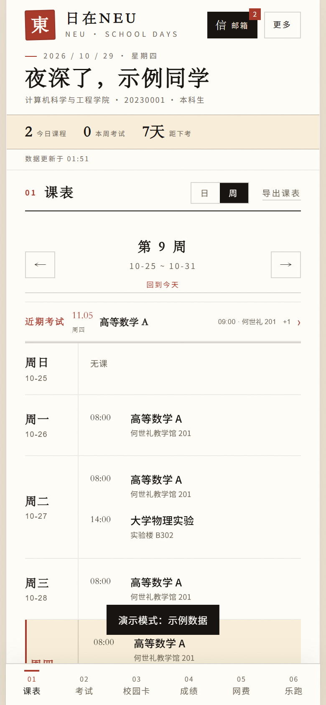
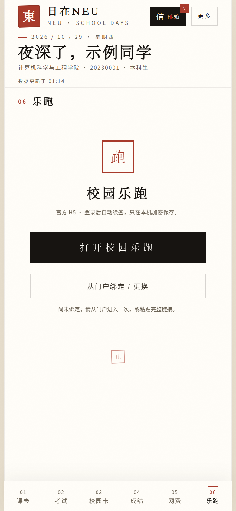
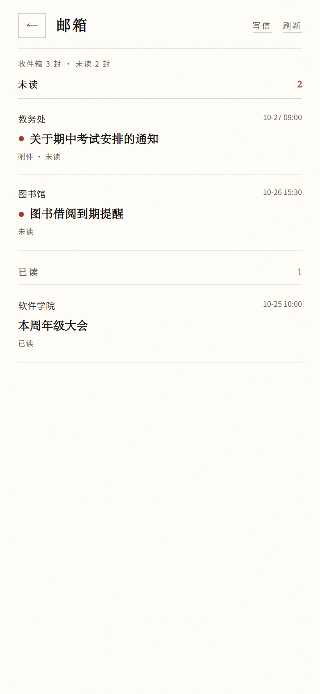
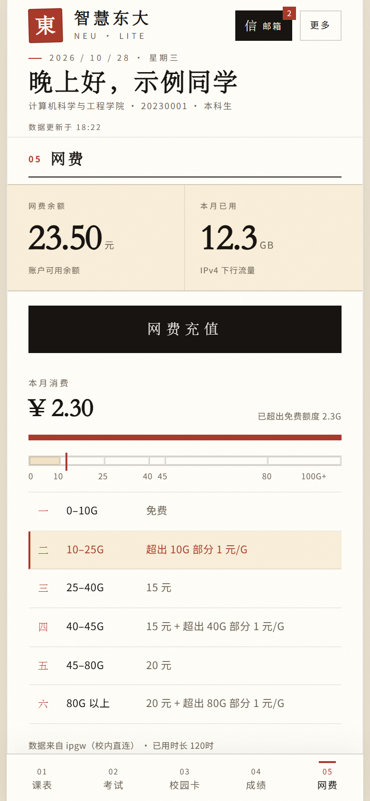

# 日在NEU

> 东北大学校园信息聚合 App：课表、考试、成绩、网费、校园卡、邮箱，以及可选的校园乐跑入口。

<p align="center">
  
</p>

> 非官方个人项目，与东北大学官方无关。仅用于访问自己的校园账号数据，请遵守学校网络与体育平台使用规则。

## 功能

- **课表**：按日/周查看、周切换、回到今天、导出加密 CSV。
- **考试**：按日期合并展示，近期考试提醒，过往考试折叠。
- **成绩**：成绩、绩点、排名。
- **网费**：余额、流量、阶梯计费说明、充值入口。
- **校园卡**：余额、e码通二维码、10 秒自动刷新、充值入口。
- **邮箱**：收件箱未读/已读分组、正文缓存、WebView 写信、原生 SMTP 发信与附件。
- **校园乐跑**：可选底部 Tab，打开官方 H5；支持从门户绑定、链接自动续签。
- **界面显示**：每个底部 Tab 可单独开关，至少保留一个。
- **本地优先**：缓存优先渲染、无空白闪烁；导出文件 AES 加密；敏感配置使用 Android Keystore。

## 界面

| 课表 | 乐跑 |
|---|---|
|  |  |

| 邮箱 | 网费 |
|---|---|
|  |  |

更多截图在 [`neu-lite/docs`](neu-lite/docs)。

## 目录结构

```text
SmartNEU/
├─ neu-lite/                 # Python 桌面端 + Web UI
│  ├─ neulite/               # 校园服务客户端
│  ├─ web/                   # 前端页面（与 Android assets 同步）
│  └─ docs/                  # 截图
├─ neu-lite-android/         # Android 原生壳 + WebView UI
│  ├─ src/                   # Java：Bridge、Api、SMTP、Keystore、乐跑链接
│  ├─ res/                   # 图标、主题
│  ├─ assets/                # Web UI
│  ├─ build.ps1              # 无 Gradle 的 APK 构建脚本
│  └─ 日在NEU.apk            # 当前稳定构建产物
├─ icon.jpg                  # 应用图标源图
├─ LICENSE                   # MIT
├─ CONTRIBUTING.md           # 贡献指南
├─ SECURITY.md               # 安全策略
├─ THIRD_PARTY_NOTICES.md    # 第三方组件说明
└─ .github/ .gitea/          # Issue / PR 模板
```

## 构建 APK

环境需要：

- JDK 11+
- Android SDK（`build-tools`、`platforms/android-36`）
- PowerShell 7（`pwsh`）

```powershell
cd neu-lite-android
pwsh -NoProfile -ExecutionPolicy Bypass -File .\build.ps1
```

产物：

```text
neu-lite-android/日在NEU.apk
```

`build.ps1` 内的 Android SDK 路径需要按本机环境修改。

## 本地 Web / 桌面端

```powershell
cd neu-lite
python -m venv .venv
.venv\Scripts\activate
pip install -r requirements.txt

# 演示数据，不需要登录
python run.py serve --demo --open

# 正式登录
python run.py login
python run.py serve --open
```

## 数据与安全

- 登录凭据、Cookie、keystore 只保存在本机应用私有目录，不进入仓库。
- 导出的状态备份与 CSV 默认使用密码加密（`.neubak` / `.neucsv`）。
- 邮箱 SMTP 专用密码、校园乐跑链接使用 Android Keystore 加密保存。
- 应用关闭了系统备份（`allowBackup=false`）。
- 仓库中不保存任何账号密码或访问令牌。
- 使用前请阅读 [SECURITY.md](SECURITY.md)。

## 许可

代码以 [MIT License](LICENSE) 开源。

- 应用图标 `icon.jpg` 不包含在 MIT 许可内，详见 [THIRD_PARTY_NOTICES.md](THIRD_PARTY_NOTICES.md)；
- 提交前请阅读 [CONTRIBUTING.md](CONTRIBUTING.md)；
- 安全问题请按 [SECURITY.md](SECURITY.md) 私下报告。

## 限制

- 校园乐跑是官方 H5 入口，不模拟轨迹、不代跑；需要先通过学校门户绑定一次。
- 原生 SMTP 不自动写入服务器「已发送」文件夹。
- 邮箱附件上限为 3 个、合计 12 MB。
- 这是个人项目，没有官方 API 稳定性保证；学校页面升级后可能需要调整。

## 说明

项目名来自《School Days》中文译名《日在校园》的改写，仅作私人使用，不代表学校官方立场。
